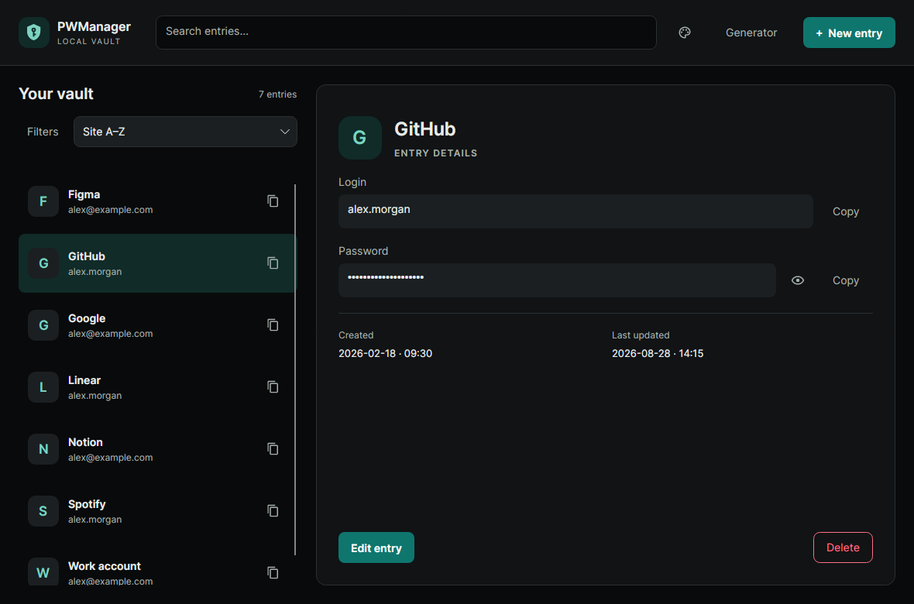
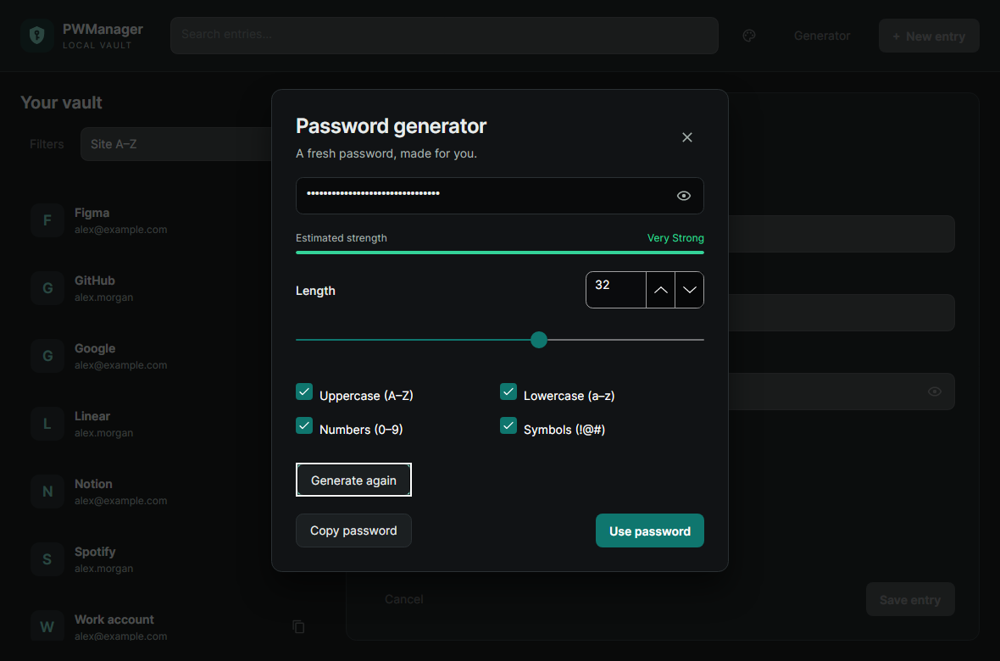
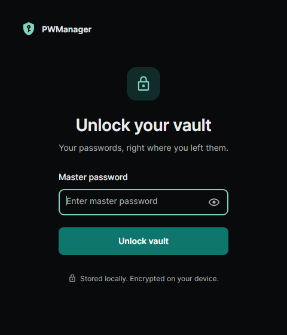

# PWManager

A personal desktop password manager built with .NET 10 and Avalonia UI. Keep credentials in a local SQLite database and find, copy, or update them through a focused dark interface.



## Features

- Neutral black and teal theme, with readable text, visible keyboard focus, and labeled actions.
- Appearance settings: choose colors for background, surfaces, text, titles, buttons, fields, and status, preview changes live, and save them as profiles. Profiles are JSON files stored outside the vault database, and the built-in Default profile matches the original palette.
- Security settings: automatic lock after idle time (or when minimized), manual lock (button or Ctrl+L), clipboard clearing for copied passwords, and automatic hiding of revealed passwords.
- Create-your-vault onboarding: a new vault asks for the master password twice and warns that there is no recovery.
- Master password change: re-encrypts every entry with a fresh key in a single transaction.
- Backup and restore from the Security dialog, using encrypted copies of the database (no plaintext export).
- AES-256-GCM encryption with PBKDF2-SHA256 (600,000 iterations), authenticated per field and derived once per session; legacy vaults are migrated automatically on unlock.
- Search across site and login, plus optional site/login filters.
- Sort by site, login, creation date, or last update, in either direction.
- Virtualized entry list with quick password copy and a separate details pane.
- Create and edit entries in a draft; changes are saved only when you choose Save.
- Field validation, explicit deletion confirmation, and a prompt before discarding unsaved changes.
- Copy login or password without revealing it; show/hide controls reset when changing context.
- Password generator with a length slider and numeric input, uppercase/lowercase, numbers, symbols, and an estimated strength indicator.
- Loading, empty-vault, no-results, and retry states, with consistent success and error messages.
- Responsive layout: list and details side by side at widths of 1000 logical pixels or more; a single pane with **Back to entries** below that.
- Application version derived from Git tags (MinVer) and shown in the window title, on the unlock screen, and in the vault header.

Vaults created by earlier versions are migrated to the v2 crypto format automatically on the first successful unlock (a transient `pwmanager.db.migrating.bak` snapshot protects the operation).

## Using the vault

On first use the app asks you to **create your vault**: choose a master password (at least 8 characters) and confirm it. There is no recovery — if you forget this password, your entries cannot be decrypted. Afterwards, **Unlock your vault** asks for the master password.

Unlocking happens in a single window: after the password is validated, the vault entries load behind one continuous progress indicator, the window grows to the vault size with a short eased transition that keeps it centered on the screen, and the vault fades in. No vault content is created or displayed before authentication, and the password field is cleared as soon as the attempt completes. Press **Ctrl+L** (or use the lock button) to lock the vault again at any time.

Search in the header, then select an entry to see its login, password, creation date, and last update. The copy icon in a list row copies its password directly. In the details pane, **Copy** is available beside both login and password.

**Filters** expands the separate site and login fields. Global search matches site **or** login; the specific filters are combined with it using **and**. Matching is case-insensitive. **Clear filters** also clears global search.

Choose **New entry** to create a credential, or **Edit entry** from its details. Site accepts either a domain or a descriptive name. Password content, including leading or trailing spaces, is preserved. Failed saves keep the draft available for another attempt. If an entry disappears during editing, **Save as new entry** lets you preserve the draft as a new record.

After saving, the saved entry remains selected. If filters hide it from the list, a message and **Clear filters** action explain how to show it again. **Cancel**, navigation away from an altered draft, and window closing prompt before discarding changes. **Delete** requires a separate confirmation.

### Password generator



Open **Generator** in the header for standalone use, or **Generate a password** in the editor.

- Length ranges from 8 to 48 characters; the default is 20.
- Changing length or character options generates a fresh password. **Generate again** regenerates manually.
- If all character options are off, lowercase letters are used and the dialog explains the fallback.
- **Copy password** copies the result.
- **Use password**, when opened from the editor, fills the current draft.
- **Use in new entry**, when opened from the header, starts a new draft and prompts before replacing unsaved work.

The strength indicator is an estimate based on the existing length/options scoring, not a guarantee about a generated password. The existing generator selects characters from the enabled pool; it does not guarantee every enabled category appears in every result.

### Keyboard shortcuts

| Shortcut | Action |
|---|---|
| Ctrl+F | Focus and select the search text |
| Ctrl+N | Start a new entry |
| Ctrl+S | Save the current editor |
| Esc | Close the generator, cancel a confirmation, or leave the current editor/pane |
| Enter | Unlock from the master password field |
| Tab / Shift+Tab | Move between controls; focus stays within an open dialog |
| Arrow keys | Navigate the entry list |

Success notifications disappear after three seconds. Errors remain until corrected, retried, or dismissed. Passwords return to their masked state when the relevant context changes.

## Requirements

- **Development:** .NET 10 SDK on Windows or Linux.
- **Framework-dependent execution:** .NET 10 Runtime and the native dependencies required by Avalonia on your OS (on Linux, X11 or Wayland plus fontconfig and FreeType).
- **Published Windows release:** the self-contained win-x64 package includes the runtime; a separate .NET installation is unnecessary.
- **Published Linux release:** the self-contained linux-x64 package includes the runtime; the target system must provide the usual desktop libraries (X11 or Wayland, fontconfig, FreeType).
- CI builds and tests the whole solution on both Windows and Linux.

## Build and run

From the repository root (the commands work in PowerShell and in a Linux shell):

```bash
dotnet restore PWManager.sln
dotnet build PWManager.sln -c Debug --no-restore
dotnet build PWManager.sln -c Release --no-restore
dotnet run --project src/PWManager/PWManager.csproj -c Release --no-build
```

To execute the compiled assembly directly:

```bash
dotnet src/PWManager/bin/Release/net10.0/PWManager.dll
```

To produce a self-contained Windows package locally:

```bash
dotnet publish src/PWManager/PWManager.csproj -c Release -r win-x64 --self-contained true -p:PublishSingleFile=true -p:IncludeNativeLibrariesForSelfExtract=true -o publish
```

To produce a self-contained Linux package locally:

```bash
dotnet publish src/PWManager/PWManager.csproj -c Release -r linux-x64 --self-contained true -p:PublishSingleFile=true -p:IncludeNativeLibrariesForSelfExtract=true -o publish
```

Run `publish/PWManager.exe` on Windows or `./publish/PWManager` on Linux, and keep the generated `appsettings.json` alongside the executable.

### Application icon on Linux

The application sets its window icon at runtime, and the Windows package embeds the executable icon. To show the icon in Linux launchers and docks, install the bundled icon and desktop entry:

```bash
install -Dm644 packaging/pwmanager.png ~/.local/share/icons/hicolor/256x256/apps/pwmanager.png
install -Dm644 packaging/pwmanager.desktop ~/.local/share/applications/pwmanager.desktop
```

Adjust `Exec` in `packaging/pwmanager.desktop` when the published binary is not on your `PATH`. `Assets/pwmanager.svg` is the source art for `Assets/pwmanager.ico`, which is referenced by the window and by the build.

## Tests

```bash
dotnet test PWManager.sln -c Release --no-build --no-restore
```

Build the Release solution first. The solution contains:

- **PWManager.UnitTests:** xUnit 2 application tests, generator and vault service tests, ViewModel/interaction tests, fake-time notification tests, a temporary SQLite persistence cycle, shell state-machine tests (nothing of the vault exists before a successful unlock, it is loaded before being revealed, and locking disposes it and zeroes the session key), crypto tests (AES-GCM tamper detection, PBKDF2 derivation, verifier), legacy-vault migration, master-password rekey, backup/restore, clipboard and auto-hide timing, settings storage, and appearance tests covering color parsing, WCAG contrast, shade derivation, anti-corruption of stored profiles, and the appearance ViewModel flows.
- **PWManager.UITests:** xUnit 3 with Avalonia.Headless.XUnit 12.0.2. Exercises production views and styles with fake credentials and services, including compiled bindings, copy actions, keyboard focus, dialogs, responsive layout, virtualization with 1000 entries, 100%/150%/200% rendering scales, the single-window unlock-to-vault transition (including Ctrl+L locking and create-your-vault mode), and live appearance previews against the shared brushes and the Fluent accent palette.

The UI test application skips production startup, so it never opens the personal vault. Persistence tests create an isolated temporary SQLite database and remove it afterward. Tests do not use the system clipboard.

To regenerate screenshots from the actual Avalonia controls with sample data:

```bash
PWMANAGER_SCREENSHOTS="$PWD/artifacts/screenshots" \
  dotnet test src/PWManager.UITests/PWManager.UITests.csproj -c Release --no-build --no-restore
```

The images in this README are headless renders of the production Avalonia views using fictitious entries. Native title bars are supplied by the OS and are not included in these renders.

Pull requests run restore, Debug/Release builds, and all tests on Windows and Linux. The existing main-branch release workflow builds and tests the entire solution, then publishes self-contained single-file packages for win-x64 and linux-x64 and attaches both archives (`.zip` and `.tar.gz`) to the GitHub release.

### Existing build notices

The redesign removes the deprecated Avalonia properties from the active views. The solution still reports pre-existing nullable-reference and cryptographic-API warnings, and the NuGet `NU1903` advisory for the transitive `SQLitePCLRaw.lib.e_sqlite3` dependency. Those warnings have not been suppressed or represented as fixed by the UI work.

## Storage and security behavior

- By default, the database is `%LocalAppData%\PWManager\pwmanager.db` on Windows and `~/.local/share/PWManager/pwmanager.db` (the XDG data location) on Linux. Windows installations from earlier versions are moved from the roaming AppData folder automatically.
- `DatabaseConfig.AppFolder` and `DatabaseConfig.DbFile` in `appsettings.json` control the location.
- Site, login, and password fields are encrypted before they are written with AES-256-GCM and a key derived with PBKDF2-SHA256 (600,000 iterations) and a per-vault salt stored in the `VaultMetadata` table. This does **not** mean the entire SQLite file is encrypted; IDs and timestamps remain database metadata.
- Vaults written by earlier versions (PBKDF2-SHA1/1,000 iterations with AES-CBC) are detected and re-encrypted to the v2 format on the first successful unlock, inside a transaction and with a transient snapshot as a safety net.
- The derived key lives in memory only while the vault is unlocked and is zeroed (`CryptographicOperations.ZeroMemory`) when the vault is locked; the master password itself is not retained.
- Locking happens automatically after the configured idle time (default 15 minutes), when the window is minimized (optional), or manually via the **Lock** button or Ctrl+L. Locking disposes the decrypted entries and clears a pending clipboard secret.
- Credentials are decrypted and held in memory during an unlocked session to support searching and use. Masking controls their visual display; revealed passwords are masked again when the window loses focus and after the configured timeout.
- Copied passwords are cleared from the clipboard after the configured time (default 25 seconds) only if the clipboard still contains that password. Clipboard history managers on Linux cannot be told to exclude the content.
- Backups are encrypted database copies created with `VACUUM INTO` (a single consistent file, no WAL side files). Restoring replaces the vault, keeps a `.before-restore` safety copy, and requires unlocking with the backup's master password.
- The application does not synchronize or transmit vault entries to a remote service.

## Architecture

| Project | Responsibility |
|---|---|
| PWManager.Domain | Entities and repository/encryption contracts |
| PWManager.Application | Application use cases |
| PWManager.Infra | SQLite/EF Core persistence and encryption |
| PWManager | Avalonia views, ViewModels, styles, and desktop services |
| PWManager.UnitTests | Application, ViewModel, interaction, and persistence tests |
| PWManager.UITests | Headless UI and rendering tests |

The UI uses CommunityToolkit.Mvvm, compiled bindings, Inter, FluentTheme, and Material Icons. ViewModels coordinate screen state, the shell transition, filters, and editor validation. Editor drafts are separate from loaded entries.

`VaultEntryService` handles loading and saving credential copies, encryption coordination, and timestamps. `PasswordGenerator` contains the character generation algorithm. Clipboard, vault entry, unlock, and navigation services are injected; notification and persistence timing use `TimeProvider`. UI service interfaces live in `Services/Interfaces`, and enums live in `Enums`, each in its own file.

The root `.editorconfig` defines indentation, braces, and line breaks. Run `dotnet format whitespace PWManager.sln --no-restore` after restoring dependencies to apply the formatting rules.

## Theme

| Role | Color |
|---|---|
| Canvas | `#090A0B` |
| Surface | `#111315` |
| Raised surface | `#1B1F21` |
| Separator | `#2A3033` |
| Primary text | `#E8ECEB` |
| Secondary text | `#A6B1AD` |
| Primary action | `#0F766E` |
| Primary action hover/pressed | `#0D655F` |
| Selected surface | `#102B28` |
| Focus/accent text | `#7DD3C0` |
| Success | `#34D399` |
| Error/destructive action | `#FB7185` |

The neutral black palette uses near-black backgrounds, charcoal panels and fields, and subtle neutral borders. Deep teal highlights primary actions and selection; muted mint marks keyboard focus and small accents. Colors, control styles, and modal overlays are shared resources. White text on the primary teal button has approximately 5.47:1 contrast; normal text targets at least 4.5:1. This release provides an English dark interface.

### Appearance profiles

Choose **Appearance** (palette icon) in the header to customize the colors. The dialog edits semantic roles rather than individual controls:

- Background, panels, raised surfaces, input fields, and borders.
- Body text, secondary text, titles, and the primary button text.
- Primary action, its hover shade, focus/accent, and the selected surface.
- Success, error, and warning colors, plus the modal overlay (with an alpha channel).

Changes preview live across the application; **Cancel** (or Esc) restores the palette that was active before the dialog opened. With "Derive related shades" enabled, hover, selection, focus, and overlay are calculated from the primary action and background colors; editing them directly switches to manual mode. A contrast check lists WCAG warnings for unreadable pairs without blocking saving, and every row can be reset to its default value.

**Save and close** persists the current colors under the name in the profile box; selecting an existing profile and renaming it renames the file. The built-in **Default** profile cannot be overwritten or deleted and always restores the original palette.

Four presets ship with the application and always appear in the profile list:

| Preset | Character |
|---|---|
| Midnight Ocean | Deep navy surfaces with a confident blue action color |
| Violet Nebula | Dark plum surfaces with a violet accent |
| Ember | Warm charcoal with a burnt-orange action color |
| Forest | Deep green surfaces with a natural green accent |

Like Default, presets cannot be edited or deleted in place: selecting one previews it live across the app, and typing a different name before **Save and close** creates your own copy. All presets are audited against the same WCAG contrast targets as the default palette.

Profiles are stored as JSON files in a `themes` folder next to the database (`%LocalAppData%\PWManager\themes` on Windows, `~/.local/share/PWManager/themes` on Linux), and the active profile name is remembered in `themes/active.json`. Nothing about appearance is written to the vault database.

### Security settings

Choose **Security** (shield icon) in the header:

- **Session** — auto-lock after an idle timeout (default 15 minutes, 0 disables), optional locking when the window is minimized, and a reminder that revealed passwords are masked when the window loses focus. The lock button and Ctrl+L lock immediately.
- **Clipboard** — copied passwords are cleared after the configured time (default 25 seconds, 0 disables) only if the clipboard still holds that password.
- **Passwords** — revealed passwords are hidden again after the configured time (default 20 seconds, 0 disables).
- **Master password** — change it by entering the current and new passwords; every entry is re-encrypted with a new key in a single transaction (a transient backup protects the operation).
- **Backup** — save an encrypted copy of the vault (`VACUUM INTO`, one consistent file) or restore one. Restoring keeps a `.before-restore` safety copy of the current vault and locks the app so it is unlocked with the backup's master password.

Preferences live in `settings.json` next to the database and are never written to the vault.


